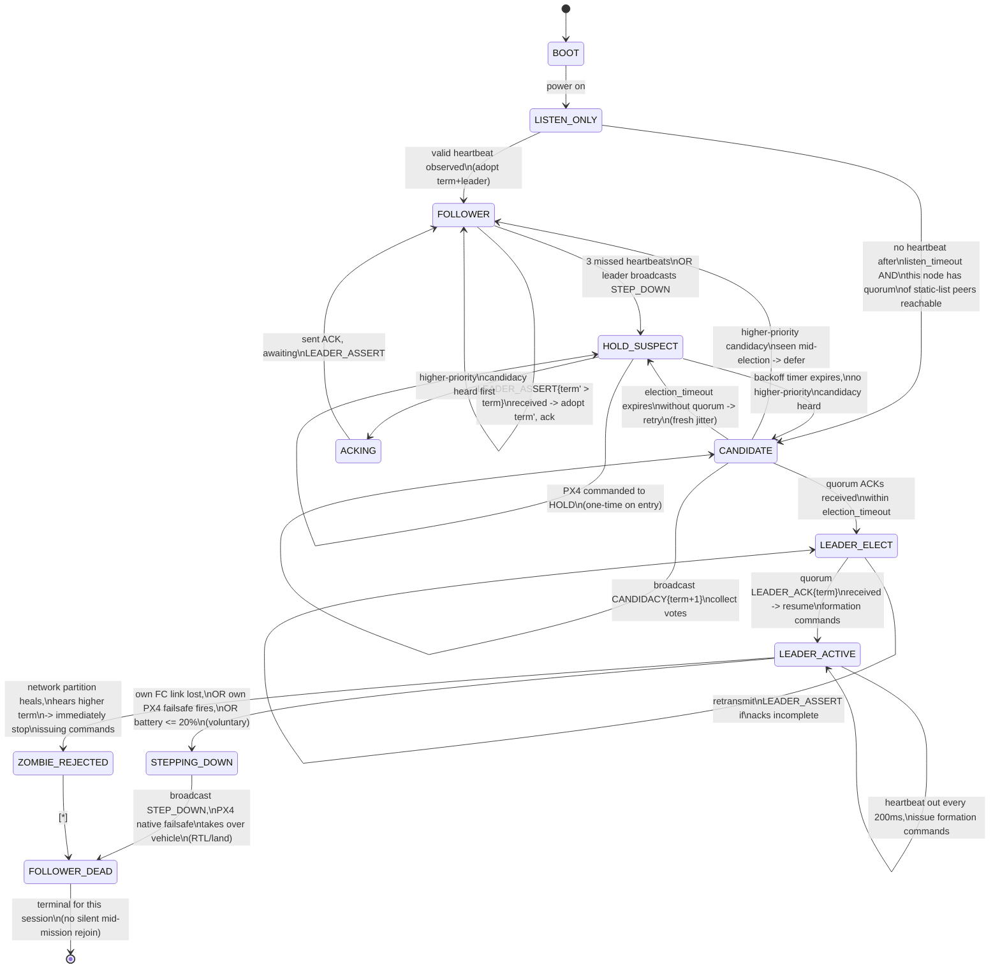

# Drone Swarm Failover Design — 5x PX4/MAVSDK, RPi 5B, LAN-only

**System:** 5 drones, formation flight, PX4 1.16.1 over UART to companion RPi 5B (RPi OS 13.6,
MAVSDK-python 3.5.13), single infrastructure-AP LAN, MAVLink over UDP broadcast for inter-drone
signaling, CLI GCS on laptop for logging only (not in the control loop).

Read this whole document before the code. Every "ASSUMPTION" tag below is a place the prompt was
ambiguous and I picked a side — flag if any is wrong for your rig, since it changes constants
downstream.

---

## 0. Assumptions made explicit up front

| # | Ambiguity in the brief | Assumption taken | Why |
|---|---|---|---|
| A1 | "battery critical" threshold not given | 20% remaining triggers a **degrade** warning broadcast (not automatic step-down); 15% triggers PX4's own battery failsafe (RTL/land) independent of our layer | PX4 already owns the hard threshold; our layer should only use battery as an *election ranking input* and a *voluntary leader step-down trigger*, not re-implement flight-critical battery failsafe |
| A2 | "position in formation / link quality / static priority" — which ranking metric | Static priority list is primary key, battery % is secondary tiebreaker, link quality (missed-heartbeat count) is tertiary | A single deterministic total order is required for Bully to converge without extra negotiation rounds. Dynamic-only metrics (battery, link) can flip mid-election if two drones sample at slightly different times — a static base order guarantees a single tie-winner even under clock drift |
| A3 | No NTP-synced clocks | Epoch/term numbers are a **monotonic integer counter**, never wall-clock time. Timeouts are measured against each drone's own local monotonic clock (`time.monotonic()`), never against timestamps received from other drones | This is the standard Raft/Bully-safe pattern — logical clocks for ordering, local monotonic clocks for timing. Never compare two machines' wall clocks for correctness decisions |
| A4 | N=5 is fixed | Quorum = majority of the **known, currently-configured** fleet (⌈5/2⌉=3), not majority-of-reachable. This is discussed as a real tradeoff in §4 | With N odd there's no even-split partition case, which simplifies quorum logic significantly vs. an even N |
| A5 | "Recovered former leader rejoin as follower? No" | A drone that failed as leader must go through a full ground-safe reboot/re-arm cycle and re-enter as a **new session** (new node instance, term counter reset by operator or persisted-and-incremented), not silently rejoin mid-mission | Per your explicit answer to Q6. This is a policy choice, not a technical necessity — noted as a real operational cost in §4 |
| A6 | Heartbeat interval/timeout not numerically given | Heartbeat every **200 ms**, leader-timeout after **3 missed** = 600 ms detection latency at the health-monitor layer | See §1 justification |
| A7 | "UDP broadcast" — is this the *only* inter-drone signaling transport | Yes, single logical channel. No redundant transport (e.g., second radio) exists, so the LAN AP is a **hard single point of failure** for the whole failover layer, not just for MAVLink telemetry | Explicitly flagged per your brief. If the AP dies, *all* drones lose each other simultaneously — no election can complete because no quorum is reachable. See §4 "no-leader deadlock" case |

---

## 1. Health monitoring — heartbeat interval & timeout justification

**Heartbeat interval: 200 ms. Timeout: 3 consecutive missed = 600 ms to suspect, plus election
time (§3) to confirm new leader.**

Why 200ms/3-miss and not something else:
- **Floor set by your 15s failover budget.** Detection + election + propagation-ack all have to
  fit inside 15s with margin. Spending under 1s on detection leaves ~14s for election/ack/PX4
  mode transitions, which is generous — so we don't need to push heartbeats faster than this and
  risk network load for no benefit.
- **Floor set by LAN jitter, not bandwidth.** At N=5, UDP broadcast at 200ms/drone is 25
  packets/sec on the LAN total — negligible for an 802.11 AP shared with 5 companion computers
  doing telemetry. Bandwidth is not the constraint; false-positive suppression is.
- **3 misses, not 1.** A single dropped UDP broadcast on a Wi-Fi AP under contention (5 vehicles +
  video/telemetry) is common and not evidence of leader failure. Requiring 3 consecutive misses
  (600ms) filters transient loss while still comfortably inside budget. This is the classic
  "detection latency vs. false-positive rate" tradeoff — **we erred toward fewer false failovers**
  because an unnecessary mid-formation-flight election is itself a flight-safety event (transient
  hold-position, PX4 mode churn), and a real leader failure will keep failing across all 3
  windows, so we lose little true-positive latency.
- If your RF environment is worse than a clean infrastructure AP (e.g. contested spectrum, longer
  range), increase interval to 300–500ms and keep the 3-miss rule — the ratio matters more than
  the absolute number.

---

## 2. Failure detection — what counts as "leader unhealthy," and distinguishing failure types

The health monitor must distinguish causes because the *response* differs:

| Signal source | Condition | Classified as | Response |
|---|---|---|---|
| Inter-drone heartbeat (UDP) | 3 consecutive missed heartbeats from leader | **Comms-lost** (Pi may be alive, network dropped, or Pi is dead) | Start election |
| Leader's own self-reported MAVLink link status (carried *inside* the heartbeat payload) | Leader's heartbeat arrives on the network but its own last field says `fc_link_ok=false` for >1s | **FC-link-severed while Pi alive** ("zombie leader" — network-healthy, vehicle-uncontrollable) | Leader is required to **immediately self-demote** (broadcast a `STEP_DOWN`) the instant it detects its own FC link loss — it must not wait to be timed out by others, since it is the only node that knows its FC link died before the network does |
| Leader's own battery telemetry | Battery % ≤ 20% (A1) | **Degrading, not yet failed** | Leader broadcasts `DEGRADE_WARN`, voluntarily calls a new election *before* it becomes unresponsive, hands off cleanly — this is the good path, distinguished from involuntary failover |
| PX4 failsafe state (via MAVSDK telemetry) on leader | RC loss / GPS loss / geofence breach / battery failsafe fires natively on leader's FC | **PX4-native failsafe** | Our layer does not fight this. PX4 wins outright (see §NFR4). Leader's companion computer detects PX4 entered failsafe mode and immediately broadcasts `STEP_DOWN` + reason, rather than waiting for a heartbeat timeout — same "detect your own death first" principle as FC-link loss |

This distinguishes **comms-lost** (default, timeout-based, the "hard" case where we can't ask the
leader anything) from **self-reported degradation** (the "soft" case, faster and cleaner because
the leader tells everyone itself). The self-reported path is strictly faster whenever it's
available — a node always knows about its own failure before the network's timeout mechanism does.

---

## 3. Leader election — Bully, ranking, ties, and storm avoidance

**Algorithm: Bully.** Justification for not using Raft: Raft's extra machinery (log replication,
persistent term/vote state surviving reboot, majority-committed log entries) exists to keep a
*replicated log* consistent across nodes. We have no replicated log to keep consistent — we only
need "exactly one node is authorized to issue formation commands at a time," which is a pure
leader-election problem. At N=5 on a single flat LAN, Bully's O(N²) worst-case message burst is
at most 25 UDP broadcasts for a full election — trivial. Raft would add implementation and
failure-mode surface (log matching, persistent state across power cycles) for a guarantee
(replicated log consistency) this system doesn't need. If N ever grows past ~15–20, or if you add
a requirement to replicate *mission state* (not just leadership) consistently, revisit Raft.

**Ranking / priority metric (deterministic total order, highest wins):**
1. Static priority list (operator-configured at mission start, e.g. drone IDs ranked 1–5) — primary key
2. Battery % at time of election trigger — tiebreaker only if static priority is somehow equal (shouldn't happen if IDs are unique, kept as defensive tiebreak)
3. Missed-heartbeat count (lower = better link quality) — final tiebreak

Because the static list is the primary key and is unique per drone, in practice **ties never
occur** — this is intentional. A ranking scheme based primarily on live metrics (pure battery %,
pure link quality) *can* tie or flip between two nodes' near-simultaneous samples under clock
drift; anchoring on a static unique key removes that whole failure class.

**Election timeout & jitter (storm avoidance):**
- On suspecting leader loss, each follower does not immediately broadcast a candidacy. It waits
  `T_backoff = base(150ms) + random_jitter(0–150ms) - (priority_rank * 20ms)`, i.e. **higher-priority
  nodes wait less**. This means the highest-priority follower almost always broadcasts its
  candidacy first.
- Any follower that hears a **higher-priority** candidacy message during its own backoff window
  immediately cancels its own candidacy and instead sends an ACK to the higher candidate. This
  collapses simultaneous multi-candidate elections (the explicit "two followers detect loss at
  the same instant" edge case) into a single winner within one backoff window (~300ms typical, worst
  case ~300ms + one RTT), well inside the 15s budget.
- If two candidacies with identical effective priority *do* race (defensive case, e.g. static list
  misconfigured with a duplicate), the tiebreak in §above resolves it deterministically since both
  nodes compute the same ordering from the same received data.

---

## 4. Split-brain prevention

**Quorum rule: strict majority of the *configured* fleet size (⌈5/2⌉ = 3), not majority-of-currently-reachable.**

Why this, and the tradeoff it implies:
- A candidate may not declare itself leader until it has collected ACKs from **at least 3 of the
  5** configured drones (including itself). This is the standard majority-quorum guarantee that
  makes two disjoint groups both reaching quorum simultaneously impossible for N=5 (3+3=6>5).
- **The real tradeoff, named explicitly:** if the LAN partitions such that no group of 3 can see
  each other (e.g., AP dies entirely, or the swarm splits into two groups of 2 and 3 — wait, 3 is
  a majority, so a 3/2 split *does* let the group of 3 elect a leader while the group of 2 correctly
  cannot). The case that produces a **no-leader deadlock** is: AP fails completely (A7) so *no*
  group of ≥3 can reach each other at all. In that case, by design, **no new leader is ever
  elected** — every drone times out waiting for quorum and falls back to its own PX4 native
  failsafe (position hold / RTL per your PX4 config). This is the correct conservative behavior:
  we accept "no leader, every drone independently fails safe" over "guess wrong and risk two
  leaders." This is stated as a residual deadlock mode in §Deadlock table below, not hidden.
- **Term/epoch numbering:** every election increments a monotonically increasing integer `term`.
  Every command a leader issues is stamped with its `term`. Followers reject any leader command
  (including from a network-partitioned-then-reconnected old leader) whose `term` is lower than
  the highest term they've already seen. This is what makes a "zombie" former leader's commands
  provably stale and rejectable without needing synced clocks (A3) — pure integer comparison.

---

## 5. Failover execution

- **Gap behavior (leader lost → new leader confirmed):** every follower immediately commands its
  own vehicle to **hold position** (PX4 `HOLD` flight mode via MAVSDK) the instant it suspects
  leader loss — it does not wait for election to finish before doing something. This directly
  answers "what happens in the gap": nobody free-flies on stale formation commands during the
  handoff window.
- **Authority propagation & ack:** once a candidate collects quorum ACKs (§4) and declares itself
  leader at term T, it broadcasts `LEADER_ASSERT{term=T}`. It **does not resume issuing mission/formation
  commands until it has received an explicit `LEADER_ACK{term=T}` from at least a quorum of
  followers**, confirming they've updated their local "current known leader/term" state and exited
  HOLD-on-ambiguity. This closes the loop: authority isn't "propagated" by one broadcast, it's
  confirmed bidirectionally before resuming active control.
- **The failed drone itself:** per your spec, PX4's own failsafe (RTL/land) governs the failed
  vehicle directly — our companion-computer layer does not try to remote-control a drone whose
  own leader-role companion process just died; that's exactly the FC-level failsafe PX4 already
  owns. The dead node is *not* treated as a "rejoin candidate" mid-mission (see §6).

---

## 6. Recovery / reintegration

Per your explicit answer: **a former leader that recovers does not silently rejoin mid-mission.**
It must land/RTL, and any re-entry to the swarm requires a fresh ground-side session start (new
process instance, term counter re-synced from the current swarm's broadcast state before it's
allowed to participate again). This trades operational convenience (no live rejoin) for a
meaningfully smaller state-consistency problem: we never have to reason about "a node that
disappeared for an unknown duration silently resuming inside a live formation with unknown state
staleness." **Late-joining/rebooted drones** (the explicit edge case) follow the same path: a
booting node listens-only for at least one full heartbeat period, adopts whatever `term` and
leader ID it observes from the network, and only starts participating (sending heartbeats,
becoming election-eligible) after it has observed at least one valid heartbeat — it never assumes
term=0 or "no leader" just because it personally never saw the election.

---

## 7. Logging & observability

Every drone logs locally (structured JSON lines, RPi local disk) on every: heartbeat-timeout
detected, candidacy started, vote cast, term incremented, leader asserted, leader ack sent/received,
step-down (voluntary or forced), PX4 failsafe observed. Each log line carries: local monotonic
timestamp, current `term`, node ID, event type, reason string. A **separate lightweight
`SWARM_LOG` UDP message type** (distinct from heartbeat/election traffic) relays these events
to the GCS CLI in near-real-time for a human-readable timeline — the GCS is receive-only and never
participates in election logic, per your "just a CLI to receive and log" spec.

---

## 8. Mermaid state machine (per-drone)



---

## 9. Message / protocol spec (LAN signaling — separate from MAVLink vehicle telemetry)

All messages are UDP broadcast, JSON payload (small N, human-debuggable > wire-efficient; revisit
if N grows large or bandwidth becomes the bottleneck — it isn't here). Every message carries a
common envelope:

```
{
  "msg_type":   string,        // one of the types below
  "node_id":    int,           // sender's static ID, 1..5
  "term":       int,           // sender's current known term (monotonic, NOT wall-clock)
  "seq":        int,           // per-node monotonically increasing sequence number, detects out-of-order delivery
  "sent_at_mono": float,       // sender's own time.monotonic() timestamp — used ONLY by the sender to compute its own RTTs, never compared cross-node
  "payload":    { ... }        // type-specific fields below
}
```

| msg_type | payload fields | purpose |
|---|---|---|
| `HEARTBEAT` | `role` ("leader"/"follower"), `battery_pct`, `fc_link_ok` (bool), `px4_failsafe_active` (bool), `missed_hb_count` | Sent by every node every 200ms. Leader's `role=leader` is what followers key their timeout logic on |
| `STEP_DOWN` | `reason` (enum: `fc_link_lost`, `px4_failsafe`, `battery_low`, `manual`) | Sent immediately by a leader detecting its own failure condition, before any follower would time it out |
| `CANDIDACY` | `priority_rank`, `battery_pct`, `missed_hb_count`, `proposed_term` | Broadcast by a node entering CANDIDATE state |
| `VOTE_ACK` | `voted_for_node_id`, `for_term` | Sent by a node deferring to a higher-priority candidate |
| `LEADER_ASSERT` | `new_term`, `leader_node_id` | Broadcast once a candidate collects quorum votes |
| `LEADER_ACK` | `ack_term`, `ack_node_id` | Sent by each follower on accepting a `LEADER_ASSERT`, required before leader resumes commands |
| `FORMATION_CMD` | `term`, `formation_target` (per-drone offset/waypoint), `cmd_seq` | The actual mission commands — followers **must** discard any `FORMATION_CMD` whose `term` is less than their locally known term. This is the concrete mechanism that neutralizes zombie-leader commands |
| `SWARM_LOG` | `event_type`, `reason`, `term`, `local_ts_mono` | Relayed to GCS only, receive-only, not used in any election/failover decision logic |

---

## 10. Architecture — module breakdown (Python / asyncio / MAVSDK-python)

```
swarm_failover/
├── models.py                # Enums, dataclasses for all message types + node state (shared, no logic)
├── mavsdk_interface.py       # Wraps MAVSDK-python per-vehicle: connect, read PX4 telemetry/failsafe
│                             # state, issue HOLD/RTL/offboard formation commands. Only module that
│                             # talks to the flight controller. Exposes async methods + telemetry
│                             # subscriptions; no election logic lives here.
├── network.py                # Thin asyncio UDP broadcast transport: send_json(msg), and an async
│                             # generator recv() yielding parsed envelope dicts. No business logic.
├── health_monitor.py         # Owns heartbeat send loop + tracks missed-heartbeat counters per peer.
│                             # Raises an asyncio.Event / callback "leader_suspected" when the
│                             # 3-miss threshold trips, or immediately on receiving STEP_DOWN.
│                             # Also watches this node's OWN mavsdk_interface telemetry to decide
│                             # when to self-broadcast STEP_DOWN (FC link lost / failsafe / battery).
├── election.py                # Pure state machine: CANDIDATE logic, backoff/jitter calc, vote
│                             # collection, quorum check, term increment. Takes network.py for I/O,
│                             # has no knowledge of MAVSDK — fully unit-testable with a fake network.
├── failover_coordinator.py    # Top-level per-drone orchestrator / asyncio task supervisor. Owns the
│                             # state machine in §8 (BOOT..FOLLOWER_DEAD). Wires health_monitor's
│                             # events into election.py's triggers, and election.py's outcomes into
│                             # mavsdk_interface.py's HOLD/resume-command calls. This is the only
│                             # module that knows about all the others.
├── gcs_relay.py               # One-way SWARM_LOG emitter, no inbound logic
└── main.py                    # Wires everything together per drone instance, reads static config
                                 # (node_id, priority_rank, peer list) from a config file/CLI arg
```

**Interfaces between modules (so they're independently testable):**
- `health_monitor.py` depends only on `network.py` (recv heartbeats) and `mavsdk_interface.py`
  (read own telemetry) — exposes `on_leader_suspected: Callback`, `on_self_failure: Callback`.
- `election.py` depends only on `network.py` — exposes `async def run_election() -> ElectionResult`,
  fully mockable with a fake in-memory network for unit tests (this is deliverable #6's "election
  logic in isolation, no hardware").
- `failover_coordinator.py` is the only module holding references to all four others; it contains
  the state-machine transition table from §8 and nothing else.
- `mavsdk_interface.py` never imports `election.py` — commands like "issue formation command" take
  a `term` parameter and the coordinator is responsible for term-gating, not the MAVSDK wrapper.

This document covers deliverables 1–4. Implementation (deliverable 5) and test plan (deliverable
6) are in the accompanying files.