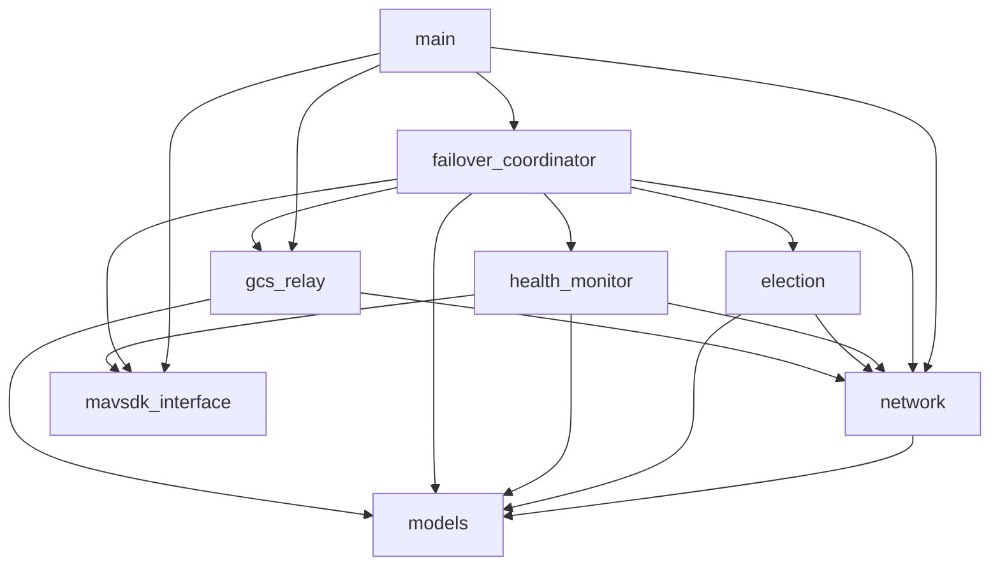
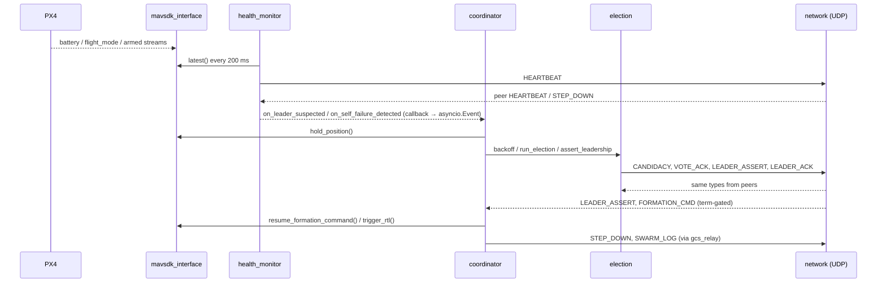

# Architecture

## Module map

```
src/
├── main.py                  CLI entry point; builds config + objects, runs the coordinator
├── failover_coordinator.py  Per-node state machine; term-gates FORMATION_CMD
├── election.py              Backoff, CANDIDACY/VOTE_ACK, LEADER_ASSERT/LEADER_ACK
├── health_monitor.py        Heartbeat send/receive, leader timeout, own-health checks
├── mavsdk_interface.py      Only module that talks to PX4 (telemetry, HOLD, offboard, RTL)
├── network.py               UdpBroadcastNetwork (real) and FakeNetwork (in-memory)
├── gcs_relay.py             Fire-and-forget SWARM_LOG emitter
└── models.py                Enums, Envelope, FleetConfig, PeerStatus, ElectionResult
```

## Dependency graph



Layering rules, which the code follows:

- `models.py` imports nothing from the project. It is the single source of
  message and state definitions.
- `election.py` uses only an object with async `send()` / `recv()`. It has no
  MAVSDK import, so you can run it against `FakeNetwork` with no hardware.
- `mavsdk_interface.py` knows nothing about terms or elections. The coordinator
  decides whether a command is allowed before it calls a flight action.
- `failover_coordinator.py` is the only module that holds references to all the
  others.

## Key classes

| Class | File | Role |
|---|---|---|
| `FleetConfig` | models.py | Frozen config: `node_id`, `priority_rank`, `all_node_ids`. Derives `fleet_size` and `quorum_size = fleet_size // 2 + 1`. |
| `Envelope` | models.py | Wire message: `msg_type`, `node_id`, `term`, `seq`, `sent_at_mono`, `payload`. JSON via `to_dict` / `from_dict`. |
| `NodeState` | models.py | `BOOT, LISTEN_ONLY, FOLLOWER, HOLD_SUSPECT, ACKING, CANDIDATE, LEADER_ELECT, LEADER_ACTIVE, STEPPING_DOWN, ZOMBIE_REJECTED, FOLLOWER_DEAD` |
| `StepDownReason` | models.py | `fc_link_lost`, `px4_failsafe`, `battery_low`, `manual` |
| `PeerStatus` | models.py | The health monitor's per-peer record (last seen time and term, role, battery, FC flags) |
| `UdpBroadcastNetwork` | network.py | Non-blocking UDP socket bound to `("", port)` that sends to `255.255.255.255:port`. Received datagrams are parsed into one `asyncio.Queue`. Malformed packets are dropped. |
| `FakeNetwork` | network.py | In-memory broadcast between instances that share the same `bus` list object. Delivers to every other instance, not to the sender. |
| `MavsdkInterface` | mavsdk_interface.py | Connects to PX4, merges battery/flight-mode/armed streams into a `VehicleTelemetryState`, exposes `latest()`, `hold_position()`, `resume_formation_command()`, `trigger_rtl()` |
| `HealthMonitor` | health_monitor.py | Four loops (see below). Raises callbacks; makes no decisions. |
| `ElectionModule` | election.py | `backoff_before_candidacy()`, `run_election()`, `assert_leadership_and_await_acks()`, `send_vote_ack()`, `send_leader_ack()` |
| `GcsRelay` | gcs_relay.py | `emit(event_type, reason, term)` schedules a `SWARM_LOG` send without awaiting it |
| `FailoverCoordinator` | failover_coordinator.py | Runs the state loop described in [state-machine.md](state-machine.md) |

## Runtime: asyncio tasks per node

Everything runs on one asyncio event loop started by `asyncio.run(main())`.

| Task | Started by | Lifetime | Purpose |
|---|---|---|---|
| `MavsdkInterface._telemetry_loop` | `connect()` | forever | Gathers `battery()`, `flight_mode()` and `armed()` streams into `_latest` |
| `UdpBroadcastNetwork._recv_loop` | `net.start()` | forever | Socket → JSON → `Envelope` → queue |
| `HealthMonitor._send_loop` | `health.run()` | forever | Broadcast `HEARTBEAT` every 200 ms |
| `HealthMonitor._recv_loop` | `health.run()` | forever | Handle `HEARTBEAT` and `STEP_DOWN` |
| `HealthMonitor._timeout_watch_loop` | `health.run()` | forever | Every 200 ms, check time since the last leader heartbeat |
| `HealthMonitor._self_health_loop` | `health.run()` | forever | While leader, check own FC link, failsafe and battery |
| Coordinator main loop | `coordinator.run()` | until `FOLLOWER_DEAD` | Dispatch per state |
| Short-lived waiters | coordinator / election | per state | Wait for the next relevant message, an event, or a timeout |

> **Important:** every consumer above reads from the *same* `net.recv()`
> queue, so each received message goes to only one of them. This is the most
> significant defect in the current code. See
> [implementation-status.md](implementation-status.md#1-shared-receive-queue-messages-are-consumed-by-only-one-reader).

## Data flow



## Callback-to-event bridging

`HealthMonitor` callbacks are plain synchronous functions. The coordinator's
handlers only set state and an `asyncio.Event`:

- `_on_leader_suspected_sync` sets `_leader_suspected_event`. A new event object
  is created on each `_enter_follower()`.
- `_on_self_failure_sync` stores the reason and sets `_self_failure_event`. A
  new event object is created at the start of each `_run_leader_active()`.
- `_on_peer_step_down_sync` only logs.

`HealthMonitor` de-duplicates leader suspicion with `_leader_suspected_fired`.
`set_role()` clears that flag on every role change.
