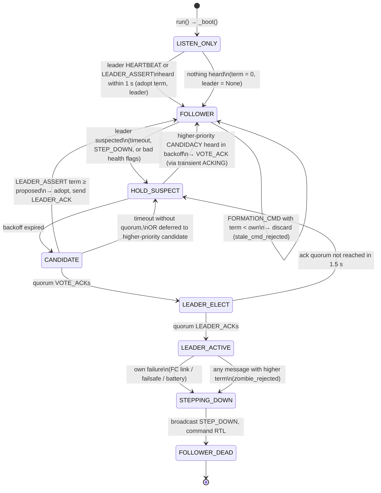

# Node state machine (as implemented)

The coordinator ([failover_coordinator.py](../src/failover_coordinator.py))
loops on `self.state` until it reaches `FOLLOWER_DEAD`, calling one
`_run_<state>()` coroutine per iteration. DESIGN.md §8 has the intended
diagram. The diagram below shows what the code does.

`BOOT` is the initial value and is never dispatched. `ACKING` is set and then
immediately replaced by `FOLLOWER` in the same coroutine. `ZOMBIE_REJECTED` is
defined in `NodeState` but never entered: the zombie path goes straight to
`STEPPING_DOWN`.

## Per-state behavior

### LISTEN_ONLY — `_boot()`
- Listens for up to `LISTEN_ONLY_TIMEOUT_S` (1.0 s) for either a `HEARTBEAT`
  with `role == "leader"` or a `LEADER_ASSERT`.
- On the first match it adopts that message's `term` and `node_id` as the
  current leader.
- Either way it enters `FOLLOWER`. If it heard nothing, it uses `term = 0` and
  `leader = None`.
- Heartbeats are already being sent during this window, because the health
  monitor starts before `_boot()`. The design says a booting node should be
  listen-only.

### FOLLOWER — `_run_follower()`
Each call waits for whichever happens first: the leader-suspected event, or the
next `LEADER_ASSERT` / `FORMATION_CMD`.
- Suspected → `HOLD_SUSPECT`.
- `LEADER_ASSERT` with `term > self.term` → adopt the term and leader, update
  the health monitor role, send `LEADER_ACK`, log `leader_ack_sent`.
- `FORMATION_CMD` with `term < self.term` → discard, log `stale_cmd_rejected`.
  Otherwise call `mavsdk.resume_formation_command(north_m, east_m, down_m, yaw_deg)`
  from `payload.formation_target`.

### HOLD_SUSPECT — `_run_hold_suspect()`
1. `mavsdk.hold_position()`: stop offboard if it was active, then `action.hold()`.
   This runs again on every retry.
2. `election.backoff_before_candidacy()` waits
   `max(0, 0.15 + U(0, 0.15) − priority_rank × 0.02)` s while listening for a
   `CANDIDACY` that outranks this node.
3. If it hears one → send `VOTE_ACK(higher, self.term + 1)`, log `deferred`,
   re-enter `FOLLOWER` (same term and leader) to wait for the winner's
   `LEADER_ASSERT`.
4. Otherwise → `CANDIDATE`.

### CANDIDATE — `_run_candidate()`
Calls `election.run_election(self.term, battery_pct, 0)`, which broadcasts
`CANDIDACY` for `term + 1` and listens for up to `ELECTION_TIMEOUT_S` (1.5 s):

| Received | Action |
|---|---|
| `VOTE_ACK` for me at the proposed term | Add the voter. If the set (including self) is ≥ quorum → **won**. |
| `CANDIDACY` at the same proposed term from a higher-ranked node | Send `VOTE_ACK` to it, return *not won, leader None* |
| `LEADER_ASSERT` with term ≥ proposed | Return *not won, leader = sender* |

The coordinator then does one of three things:
- won → `term = new_term`, `LEADER_ELECT`
- lost with a known leader → `FOLLOWER` at that term, plus `LEADER_ACK`
- lost with no leader (timeout **or** deferral) → log `election_timeout`,
  `HOLD_SUSPECT`

### LEADER_ELECT — `_run_leader_elect()`
`assert_leadership_and_await_acks(term)` broadcasts `LEADER_ASSERT` and collects
`LEADER_ACK`s for this term for up to 1.5 s.
- Quorum (self counts) → `LEADER_ACTIVE`, `health.set_role("leader", ...)`, log `leader_active`.
- No quorum → log `leader_ack_quorum_failed`, `HOLD_SUSPECT`.

### LEADER_ACTIVE — `_run_leader_active()`
Waits for whichever happens first:
- the self-failure event (raised by the health monitor's `_self_health_loop`), or
- any received envelope whose `term` is greater than the leader's own term.

Both lead to `STEPPING_DOWN`. The higher-term case logs `zombie_rejected` and
adopts the higher term first.

The leader does **not** generate `FORMATION_CMD`s. There is no mission or
formation planner in the codebase (see implementation-status).

### STEPPING_DOWN — `_run_stepping_down()`
Broadcasts `STEP_DOWN{reason}`, logs `step_down`, calls `mavsdk.trigger_rtl()`
(stop offboard, `action.return_to_launch()`), then sets `FOLLOWER_DEAD`. The
reason is the stored self-failure reason. A zombie step-down has none stored,
so it reports `manual`.

### FOLLOWER_DEAD
Terminal. The main loop exits and cancels the health task, so heartbeats stop.
`main()` then returns. Per DESIGN.md assumption A5, the drone can rejoin only
through a new ground-side session.

## GCS event types emitted

| `event_type` | Emitted when |
|---|---|
| `state_transition` | BOOT→LISTEN_ONLY, →FOLLOWER, →HOLD_SUSPECT |
| `peer_step_down` | A `STEP_DOWN` is received from any peer |
| `leader_ack_sent` | A follower accepts a `LEADER_ASSERT` |
| `stale_cmd_rejected` | A `FORMATION_CMD` from an older term is discarded |
| `deferred` | A node in backoff yields to a higher-priority candidate |
| `candidacy_started` | A node enters `run_election` |
| `election_won` | Vote quorum reached |
| `election_timeout` | An election ended without a leader (also logged on mid-election deferral) |
| `leader_active` | `LEADER_ACK` quorum reached |
| `leader_ack_quorum_failed` | `LEADER_ACK` quorum not reached |
| `zombie_rejected` | A leader saw a higher term |
| `step_down` | `STEP_DOWN` broadcast |
